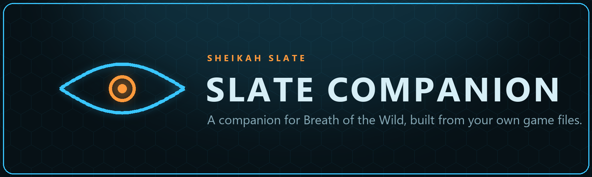
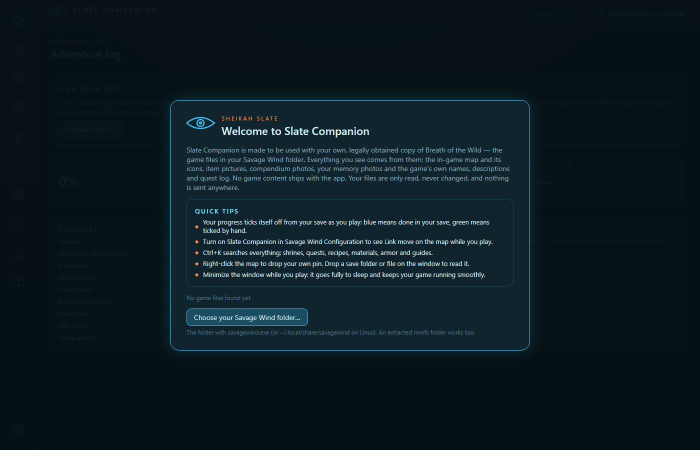
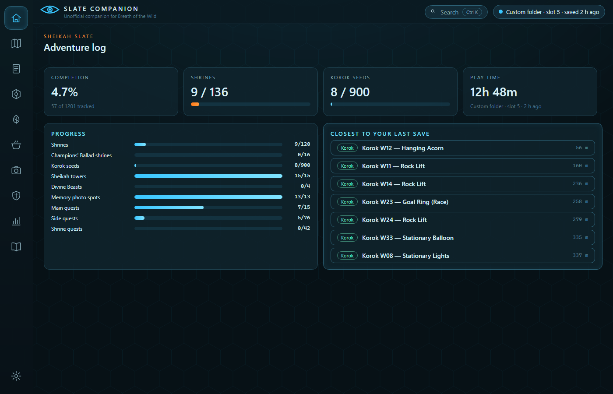
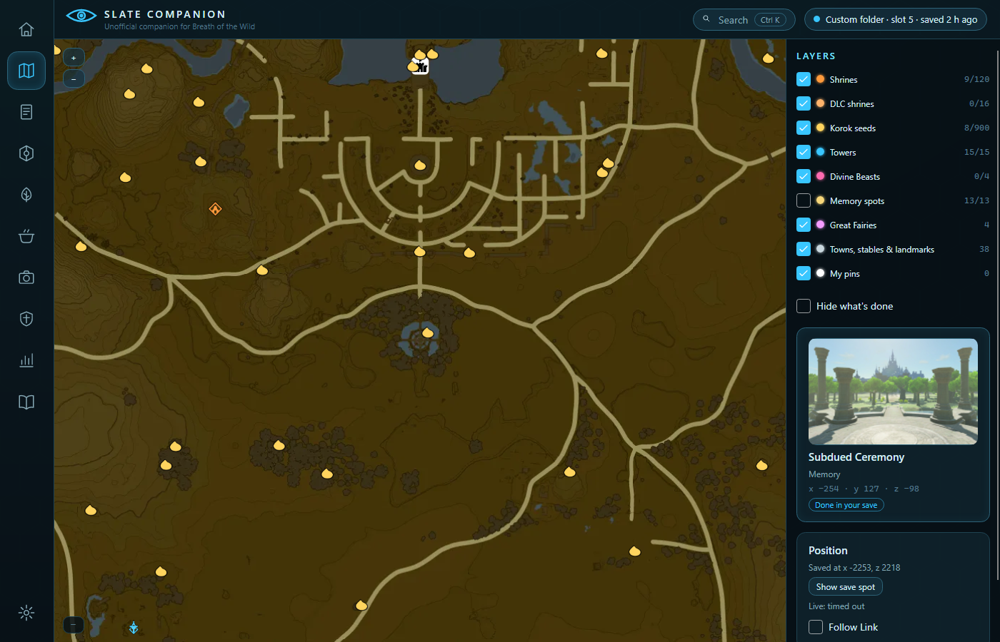
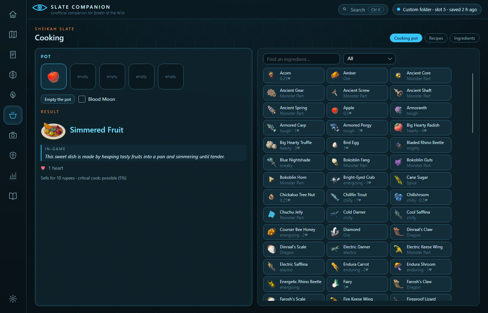
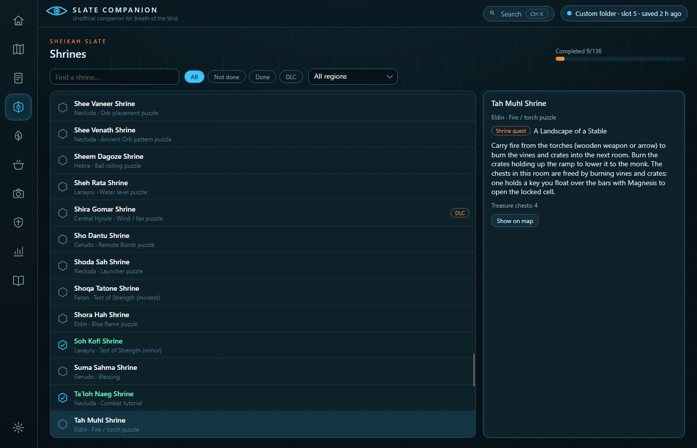
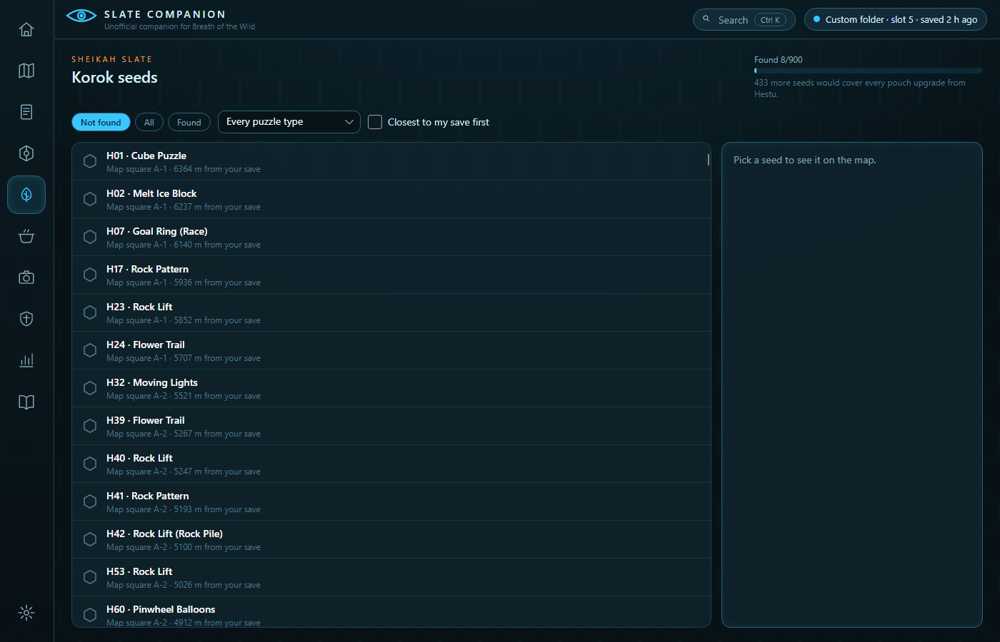
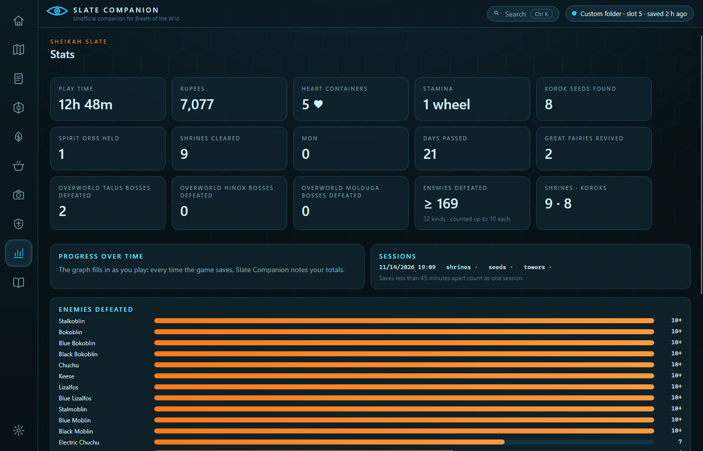
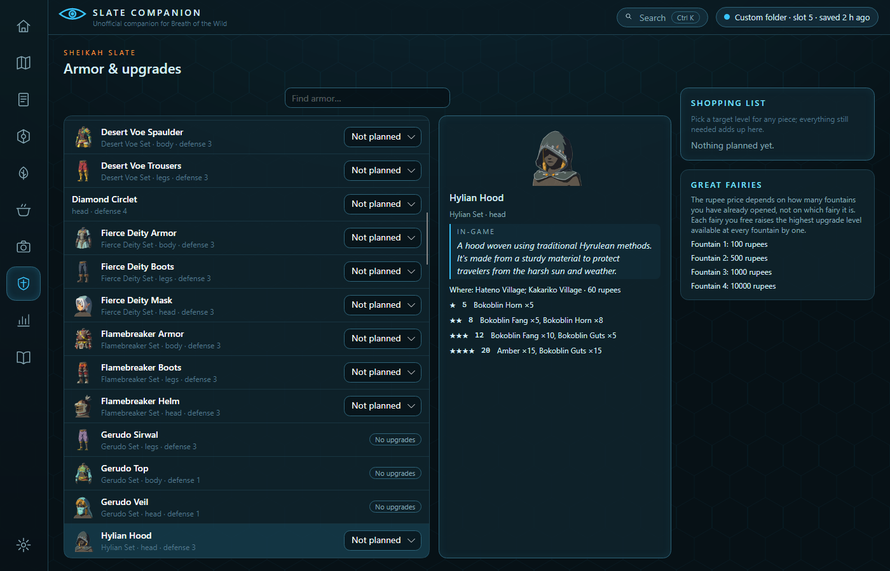
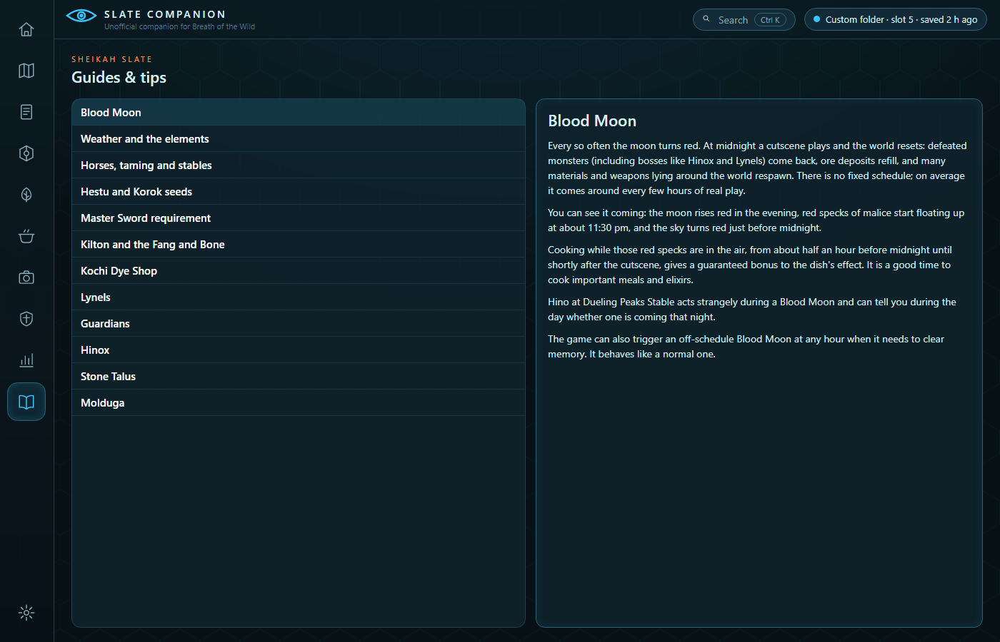

<p align="center"></p>

**Slate Companion** is a companion app for *The Legend of Zelda: Breath of the Wild* on Windows and Linux, styled after the Sheikah Slate. It reads your save while you play and ticks off shrines, Korok seeds, towers, memories and quests by itself, shows the in-game map with Link's live position from [Savage Wind Recomp](https://github.com/Revivedx/SavageWindRecomp), and puts a walkthrough, every quest, a cooking simulator, the Hyrule Compendium, armor upgrades and your stats in one place. Everything it shows from the game comes from **your own copy**, built once from your Savage Wind folder.

**[⬇ Download Slate Companion](https://devall96.github.io/SlateCompanion/)** · [All releases](https://github.com/devall96/SlateCompanion/releases) · [Install it](#how-to-install) · [What it does](#what-it-does) · [Live position](#links-position-live-from-savage-wind)

> [!CAUTION]
> **No game files are included, and none ever will be**: not in the code, the releases, the issues or the wiki. Slate Companion is made to be used with your own, legally obtained copy of Breath of the Wild: the game files in your Savage Wind folder, dumped from your own Switch. On first start it asks for that folder and builds the map, icons, pictures and in-game text from it, on your PC. Please don't post game files, dumps, keys or the built files here.

> [!IMPORTANT]
> **Made with AI.** Every line of code in Slate Companion, every test, the art and this page were written or made by Claude, Anthropic's AI, through Claude Code. A human, [devall96](https://github.com/devall96), came up with the idea, directs it and tests every build, but no human reviews the code line by line. [Who did what](#who-did-what) has the details. If you don't want to run code written that way, don't run this. As with anything on the internet, you run it at your own risk.

> [!WARNING]
> **Early, and tested on one PC.** Slate Companion 0.1 has been run on one Windows PC against real Savage Wind saves. The Linux AppImage is built and packaged automatically but hasn't been tried on a Linux desktop yet. It only ever **reads** your saves, but it's still worth keeping a copy of any you care about.

> [!NOTE]
> **Not official.** Slate Companion is a fan-made app. It isn't made by, affiliated with or endorsed by Nintendo or the Savage Wind Recomp team. Please don't report Slate Companion problems to Savage Wind: [open an issue here](https://github.com/devall96/SlateCompanion/issues) instead.

## Screenshots

<p align="center"></p>
<p align="center"><sub>The first start: Slate Companion asks for your Savage Wind folder and builds everything from your own game files.</sub></p>

| | |
| --- | --- |
|  |  |
|  |  |
|  |  |
|  |  |
|  |  |

The map, icons, item pictures, compendium photos, memory photos and in-game text in these screenshots were built from a legally obtained copy of the game, as they are on your PC. They're © Nintendo and aren't part of Slate Companion.

## What it does

**Your progress, from your save**
- Reads your save and **ticks things off by itself as you play**: all 136 shrines, 900 Korok seeds, 15 towers, the Divine Beasts, memories, and the main, side and shrine quests. Blue means done in your save; anything else you can tick by hand (green).
- Finds saves by itself: **Savage Wind** (every save profile), Cemu, Ryujinx and Yuzu-family emulators. You can also pick a folder or a save file, or drop one on the window.
- **Only ever reads.** A save is opened read-only, read in one go and closed, after the game has finished writing it. Slate Companion never changes, moves or copies over a save.

**The map**
- **The in-game map**, built from your own game files at 3 pixels per game unit: sharp at full zoom.
- **The game's own map icons** for shrines, towers, Korok seeds, stables, villages, the castle and Tech Labs. Done things turn blue, or hide.
- **Link's live position** and facing from Savage Wind, with **Follow Link**. Your save spot, your own pins (right-click), and the **photo from your album** at each captured-memory spot.

**Everything else**
- **Quests & walkthrough**: the story chapter by chapter with both DLC packs, all 15 main, 76 side and 42 shrine quests, with the **game's own quest log** next to step-by-step notes.
- **Shrines**: all 136 with a short solution, chest count and the shrine quest behind the hidden ones.
- **Korok seeds**: by map square and puzzle type, or the closest to your save first.
- **Cooking**: a pot simulator that uses the game's own rules (checked against 617 real in-game results), every recipe and ingredient, with **item icons** and the **game's descriptions**.
- **Hyrule Compendium**: all 389 entries with the **compendium photo** and the game's own entry text.
- **Armor & upgrades**: every piece with its icon, the Great Fairy materials per level, and a **shopping list** for the levels you want.
- **Stats**: play time, rupees, hearts, stamina, days, enemies defeated, progress over time and play sessions.
- **Guides**: Blood Moon, weather, horses, Hestu, the Master Sword, shops and boss tips.
- **Search everything** with Ctrl+K.

**Light enough to leave open while you play**
- A native app (no browser engine inside), drawn in software so the game keeps the graphics card, at below-normal priority.
- It does nothing until something changes: a save written, Link moving, you clicking. **Minimize it and it goes fully to sleep.**
- The game files are read once, when it builds; while you play it only shows what was built.

## How to install

**Windows:** download **[SlateCompanion-win-Setup.exe](https://github.com/devall96/SlateCompanion/releases/latest/download/SlateCompanion-win-Setup.exe)** and run it. It installs for your user only (no admin), adds a Start menu entry, and can update itself later from **Saves & settings → Updates**.

**Linux:** download **[SlateCompanion.AppImage](https://github.com/devall96/SlateCompanion/releases/latest/download/SlateCompanion.AppImage)**, make it executable (`chmod +x SlateCompanion.AppImage`, or Properties → Allow executing) and run it.

**First start:** Slate Companion looks for Savage Wind on your PC and lists its game files; press **Use these**, or **Choose your Savage Wind folder…** (the folder with `savagewind.exe`, or `~/.local/share/savagewind` on Linux). It builds the map, icons, pictures and text once, in under a minute, and opens. Then it finds your saves by itself.

You need Savage Wind set up with your own game files, the same as for playing it. An extracted `romfs` folder from your own dump works too.

## Link's position, live from Savage Wind

The map can show where Link is while you play, by asking Savage Wind over a **read-only** connection on your own PC (`127.0.0.1:7777`). It only reads Link's position, his facing and the time of day: it can't change, move or close the game.

That needs a **Slate Companion** switch on Savage Wind's start screen, which isn't in a Savage Wind release yet. Until it is, the live position simply stays off and everything else works as normal.

## Your data

- **Nothing is sent anywhere.** No accounts, no telemetry, no ads. The only time it goes online is when you press **Check for updates**.
- Your ticks, pins and history are kept in `%APPDATA%\SlateCompanion` (Windows) or `~/.config/slatecompanion` (Linux), next to what it built from your game files. Delete that folder to start over.

## Building it

.NET 10 SDK, then:

```
dotnet run --project src/SlateCompanion
```

`build-release.ps1` makes the Windows installer with [Velopack](https://velopack.io); the Linux AppImage is built by `.github/workflows/linux.yml`. `--screenshots <folder>` saves a picture of every screen, and `--build-map <romfs>` builds from game files without the window.

## Who did what

- **[devall96](https://github.com/devall96)**: the idea, the direction, every decision, and testing every build with real saves and Savage Wind.
- **Claude** (Anthropic), through Claude Code: the code, the save and game-file readers, the data gathering, the art and the documentation.

## Credits

Slate Companion stands on other people's work. The facts it ships with (names, coordinates, flag names, numbers) come from:

- [objmap](https://github.com/zeldamods/objmap) and the zeldamods project: shrine, tower, Korok and place positions (facts only; no map images are used)
- [marcrobledo/savegame-editors](https://github.com/marcrobledo/savegame-editors) (MIT): save flag names, checked against real saves
- [Pistonite/botw-recipe](https://github.com/Pistonite/botw-recipe) (MIT) and [savage13/cooking.rs](https://github.com/savage13/cooking.rs) (BSD-2-Clause): cooking data, rules and the 617 test results
- The [Hyrule Compendium API](https://github.com/gadhagod/Hyrule-Compendium-API) (MIT): compendium entries, locations and drops
- The zeldamods wiki (CC BY-SA 4.0): save format facts

All guide text was written for Slate Companion. Full details and licences: [THIRD_PARTY_NOTICES.md](THIRD_PARTY_NOTICES.md) and the `SOURCES` files in `src/SlateCompanion/Data`. Built with [Avalonia](https://avaloniaui.net), [SkiaSharp](https://github.com/mono/SkiaSharp) and [Velopack](https://velopack.io).

*The Legend of Zelda: Breath of the Wild* is © Nintendo. Slate Companion is not affiliated with Nintendo.

## License

[MIT](LICENSE).
