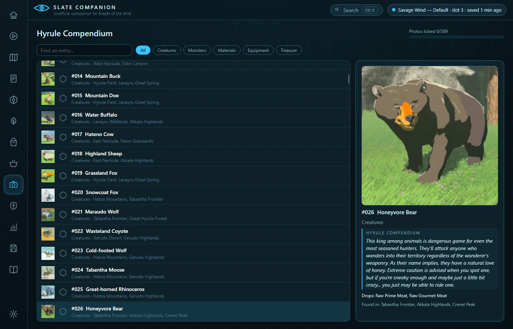
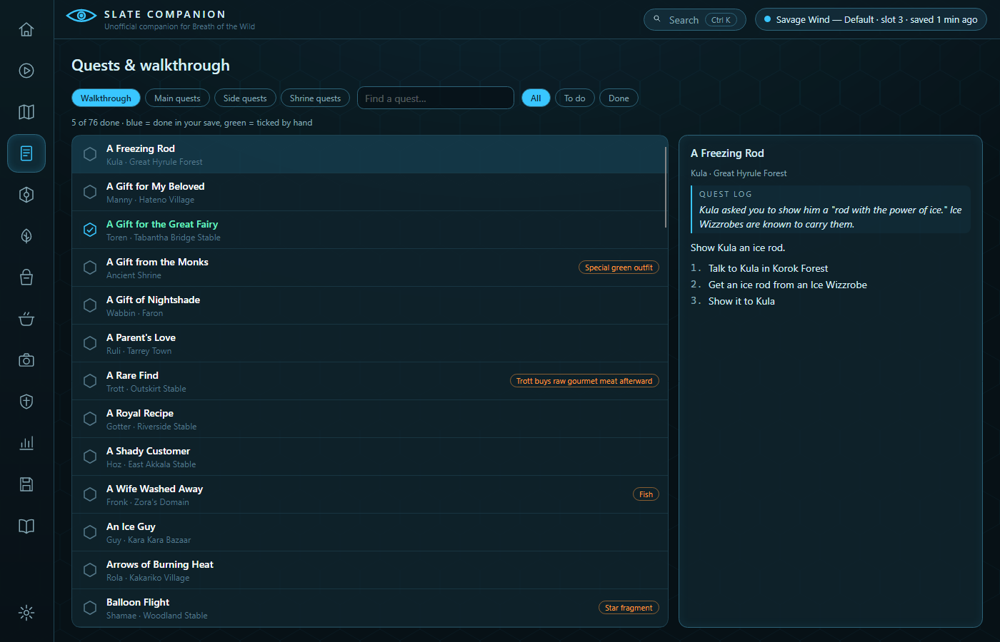
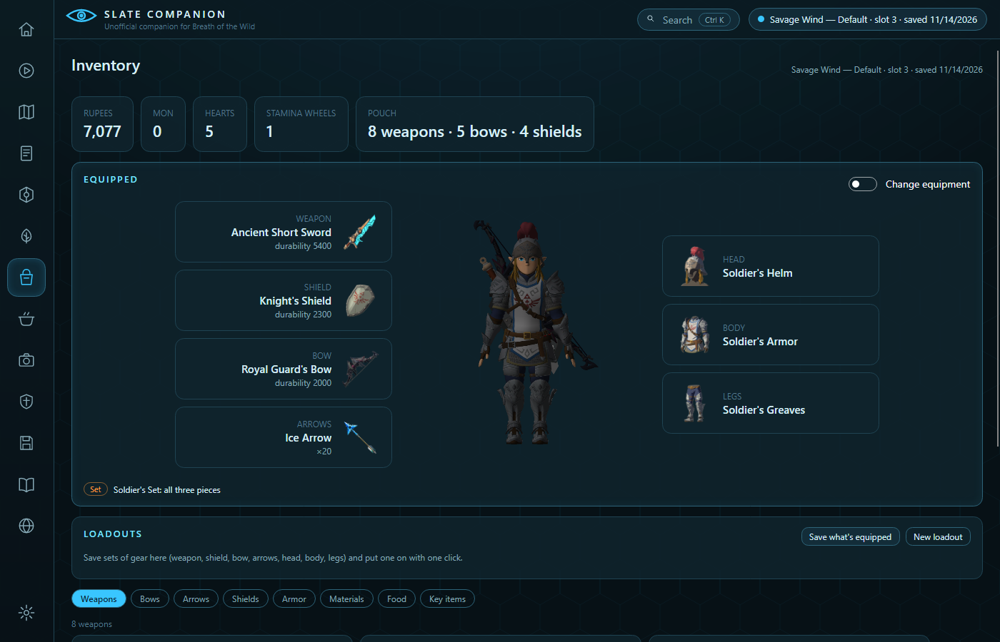
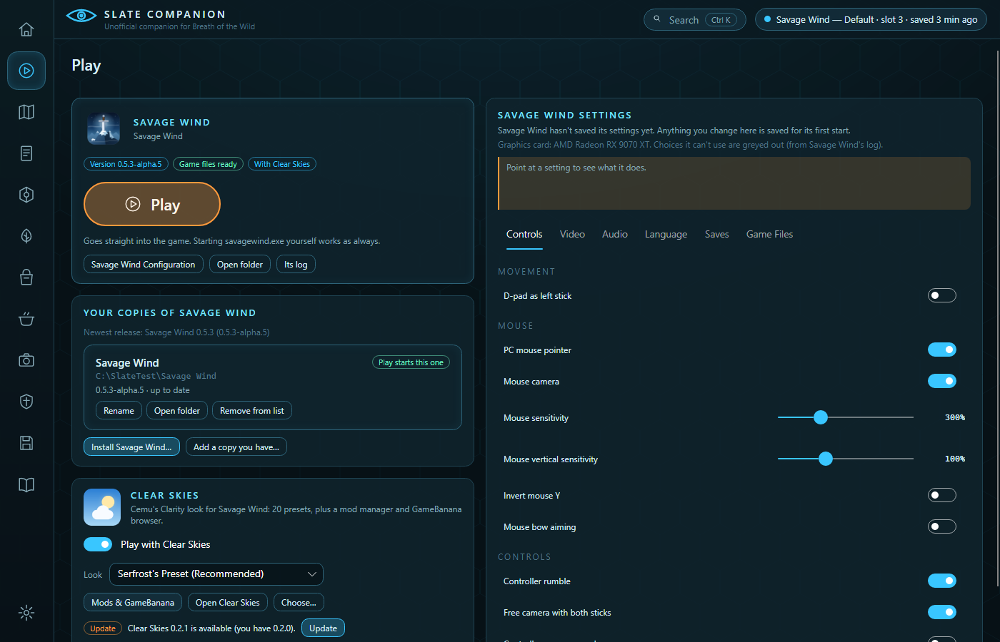
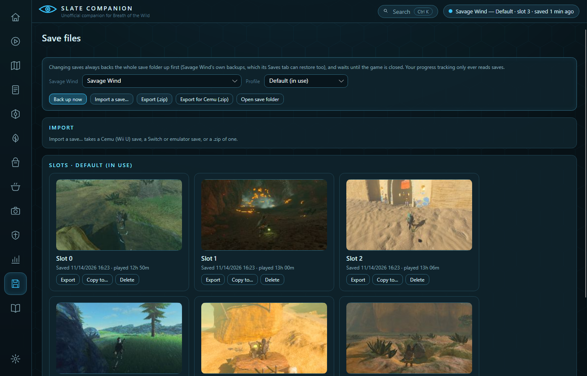

<p align="center"></p>

**Slate Companion** is a companion app for *The Legend of Zelda: Breath of the Wild* on Windows and Linux, styled after the Sheikah Slate. It reads your save while you play and ticks off shrines, Korok seeds, towers, memories and quests by itself, shows the in-game map with Link's live position from [Savage Wind Recomp](https://github.com/Revivedx/SavageWindRecomp), and puts a walkthrough, every quest, a cooking simulator, the Hyrule Compendium, armor upgrades, your inventory and your stats in one place, and manages your save files. It can also start Savage Wind for you, with [Clear Skies](https://github.com/devall96/ClearSkies) if you use it. Everything it shows from the game comes from **your own copy**, built once from your Savage Wind folder.

**[⬇ Download Slate Companion](https://devall96.github.io/SlateCompanion/)** · [All releases](https://github.com/devall96/SlateCompanion/releases) · [Install it](#how-to-install) · [What it does](#what-it-does) · [Play](#play-savage-wind-optional) · [Live position](#links-position-live-from-savage-wind)

> [!CAUTION]
> **No game files are included, and none ever will be**: not in the code, the releases, the issues or the wiki. Slate Companion is made to be used with your own, legally obtained copy of Breath of the Wild: the game files in your Savage Wind folder, dumped from your own Switch. On first start it asks for that folder and builds the map, icons, pictures and in-game text from it, on your PC. Please don't post game files, dumps, keys or the built files here.

> [!IMPORTANT]
> **Made with AI.** Every line of code in Slate Companion, every test, the art and this page were written or made by Claude, Anthropic's AI, through Claude Code. A human, [devall96](https://github.com/devall96), came up with the idea, directs it and tests every build, but no human reviews the code line by line. [Who did what](#who-did-what) has the details. If you don't want to run code written that way, don't run this. As with anything on the internet, you run it at your own risk.

> [!WARNING]
> **Early, and tested on two PCs.** Slate Companion 0.3 has been run on Windows against real Savage Wind saves and a real Savage Wind install, and earlier versions on Ubuntu. Updating an existing Savage Wind to a newer release hasn't been tried yet (there hasn't been a newer release to update to). Your progress is only ever **read** from your saves; the Save files screen and Change equipment change saves only when you ask, and back them all up first. It's still worth keeping a copy of any you care about.

> [!NOTE]
> **Not official.** Slate Companion is a fan-made app. It isn't made by, affiliated with or endorsed by Nintendo or the Savage Wind Recomp team. Please don't report Slate Companion problems to Savage Wind: [open an issue here](https://github.com/devall96/SlateCompanion/issues) instead.

## Screenshots

<p align="center"></p>
<p align="center"><sub>The first start: Slate Companion asks for your Savage Wind folder and builds everything from your own game files.</sub></p>

| | |
| --- | --- |
|  |  |
|  |  |
|  |  |
|  |  |
|  |  |
|  |  |

The map, icons, item pictures, compendium photos, memory photos and in-game text in these screenshots were built from a legally obtained copy of the game, as they are on your PC. They're © Nintendo and aren't part of Slate Companion.

## What it does

**Your progress, from your save**
- Reads your save and **ticks things off by itself as you play**: all 136 shrines, 900 Korok seeds, 15 towers, the Divine Beasts, memories, and the main, side and shrine quests. Blue means done in your save; anything else you can tick by hand (green).
- Finds your **Savage Wind** saves by itself, across every save profile. You can also pick a folder or a save file, or drop one on the window.
- **Tracking only ever reads.** A save is opened read-only, read in one go and closed, after the game has finished writing it. Only the Save files screen changes saves, and only when you ask (see below).

**The map**
- **The in-game map**, built from your own game files at 3 pixels per game unit: sharp at full zoom.
- **The game's own map icons** for shrines, towers, Korok seeds, stables, villages, the castle and Tech Labs. Done things turn blue, or hide.
- **Link's live position** from Savage Wind (*coming soon: [needs the next Savage Wind release](#links-position-live-from-savage-wind)*), with **Follow Link**, a **cone showing where the camera looks**, and the map **darkening at night and warming at dawn and dusk** with the game's clock. Your save spot, your own pins (right-click), and the **photo from your album** at each captured-memory spot.

**Everything else**
- **Quests & walkthrough**: the story chapter by chapter with both DLC packs, all 15 main, 76 side and 42 shrine quests, with the **game's own quest log** next to step-by-step notes. **The walkthrough follows your save**: its steps and chapters tick themselves (shrines, towers, towns reached, quests started or finished, Divine Beasts entered or freed), and turning on *Tick from my save* ticks everything you've already done.
- **Shrines**: all 136 with a short solution, chest count and the shrine quest behind the hidden ones.
- **Zelda Dungeon tab**: [Zelda Dungeon](https://www.zeldadungeon.net/)'s own guide, shown as it is inside the app, with a **Read on Zelda Dungeon** button on every chapter, quest and shrine that opens its page. Nothing of theirs is copied into the app. It goes quiet when you don't use it: the page is closed 30 seconds after you leave the tab or the window, and at once when you minimize or Savage Wind is running.
- **Korok seeds**: by map square and puzzle type, or the closest to your save first.
- **Cooking**: the game's own cooking pot (drawn from your game files): drag ingredients in or click them. It uses the game's own rules (checked against 617 real in-game results), every recipe and ingredient, with **item icons** and the **game's descriptions**.
- **Hyrule Compendium**: all 389 entries with the **compendium photo** and the game's own entry text.
- **Armor & upgrades**: every piece with its icon, the Great Fairy materials per level, and a **shopping list** for the levels you want.
- **Inventory**: everything in Link's pouch with the game's own pictures, names and descriptions: weapons with durability and bonuses, bows, arrows, shields, armor with its ★ level, materials, food and key items, plus rupees, Mon, hearts, stamina and pouch sizes. **Link in 3D** in what he has equipped, drawn on your graphics card from your own game files (drag to turn him), and your armor set's bonus.
- **Change equipment** (opt-in): equip and take off, or drag an item onto Link's slot. **Loadouts**: save sets of gear, preview them on Link and put one on with a click. This edits your save, so it only works while Savage Wind is closed, and backs everything up first.
- **Stats** on the Adventure log: rupees, hearts, stamina, spirit orbs, Mon, days, Great Fairies, bosses, progress over time and play sessions.
- **Guides**: Blood Moon, weather, horses, Hestu, the Master Sword, shops and boss tips.
- **Search everything** with Ctrl+K.

**Play Savage Wind (optional)**

The Play screen starts Savage Wind for you. You choose on the first start, and can turn it off any time in Settings. Slate Companion never installs, updates or changes Savage Wind.
- **Play** starts Savage Wind the normal way, as if you opened it yourself: it shows its Configuration screen or an update first when it wants to.
- **Your copies**: every copy of Savage Wind on your PC, with a name of your own: pick which one Play starts, open its folder, or remove it from the list (nothing is deleted).
- **[Clear Skies](https://github.com/devall96/ClearSkies)**: play with Cemu's Clarity look and pick one of its 20 presets, open its mod manager and GameBanana browser, and update it with one button when it has a new version.

**Save files**
- Every slot of every Savage Wind copy and save profile, with its picture, date and play time.
- **Back up**, **restore** a backup, **import** a save (from another Savage Wind copy or a .zip), import one slot into another, **export** as a .zip, **copy** a slot to another slot, profile or copy, and **delete** one.
- Every change backs the whole save folder up first, into Savage Wind's own backup folder (its Saves tab can restore them too), takes Savage Wind's save lock, and never runs while the game is open.

**Light enough to leave open while you play**
- A native app (no browser engine inside), drawn on the graphics card (or in software, in Settings) at below-normal priority.
- It does nothing until something changes: a save written, Link moving, you clicking. **Minimize it, or click over to the game, and it goes fully to sleep**: no timers, no drawing, until you come back. (The map's live position can keep moving in the background for a second screen: Settings.)
- The game files are read once, when it builds; while you play it only shows what was built.

## How to install

**Windows:** download **[SlateCompanion-win-Setup.exe](https://github.com/devall96/SlateCompanion/releases/latest/download/SlateCompanion-win-Setup.exe)** and run it. It installs for your user only (no admin), adds a Start menu entry, and checks for its own updates when it opens (one small request; you can turn that off in **Saves & settings → Updates**).

**Linux:** download **[SlateCompanion.AppImage](https://github.com/devall96/SlateCompanion/releases/latest/download/SlateCompanion.AppImage)**, make it executable (`chmod +x SlateCompanion.AppImage`, or Properties → Allow executing) and run it. On the first start, pick your Savage Wind AppImage (its saves and game files are found from it), and turn on **Add to applications** to have Slate Companion and Savage Wind in your app menu.

**First start:** Slate Companion looks for Savage Wind on your PC and lists its game files; press **Use these**, or **Choose your Savage Wind folder…** (the folder with `savagewind.exe`, or `~/.local/share/savagewind` on Linux). It builds the map, icons, pictures and text once, in under a minute, and opens. Then it finds your saves by itself. The welcome screen also asks whether you want the Play screen.

You need Savage Wind set up with your own game files, the same as for playing it. An extracted `romfs` folder from your own dump works too.

## Link's position, live from Savage Wind

> [!NOTE]
> **Coming soon.** The live position needs a small piece inside Savage Wind itself: its read-only *companion socket*. That's on Savage Wind's `test` branch now, but **not in any Savage Wind release yet** (Alpha 6 and older don't have it). Until a release includes it, **Test** (under Live position) in Slate Companion says "not connected" whatever you set, and everything else works as normal. Sorry for shipping the switch before the game side was out!

The map can show where Link is while you play, by asking Savage Wind over a **read-only** connection on your own PC (`127.0.0.1:7777`). It only reads Link's position, which way the camera looks and the time of day: it can't change, move or close the game. The map then shows a cone where the camera looks, and darkens at night and warms at dawn and dusk (both can be turned off on the map).

**Turning it on, once your Savage Wind has it:**
1. Start Savage Wind. On its start screen (**Savage Wind Configuration**), turn on **Companion apps**. It's saved in `savagewind.ini` (`companion_apps`), so this is once only. It opens the connection at once; turning it off takes effect the next time Savage Wind starts.
2. In Slate Companion, open **Saves & settings → Live position (Savage Wind)**, leave the port at **7777** and press **Test** once you've loaded a save.
3. Open the map. Link shows up within a second.

Using another port: start Savage Wind with the launch option `SAVAGEWIND_COMPANION=<port>` (for example `SAVAGEWIND_COMPANION=7788`) and set the same port in Slate Companion. You don't need to run either as administrator. If Savage Wind was started with its developer socket (`SAVAGEWIND_CONTROL`), use that port instead.

## Your data

- **Nothing is sent anywhere.** No accounts, no telemetry, no ads. It goes online only to ask GitHub for new versions: of Slate Companion when it opens (can be turned off), and of Clear Skies when you open the Play screen. The Zelda Dungeon tab loads zeldadungeon.net (with its ads) only while you use it, and up to 30 seconds after; its cookies are kept in the `web` folder next to your ticks.
- **Logs**: `logs/slatecompanion.log` and crash reports (`logs/crash-*.txt`) in the same folder, with your user name taken out of paths. When something goes wrong, an error window shows the details with **Copy details**, **Open logs folder** and **Report a problem**.
- Your ticks, pins and history are kept in `%APPDATA%\SlateCompanion` (Windows) or `~/.config/slatecompanion` (Linux), next to what it built from your game files. Delete that folder to start over.

## Building it

.NET 10 SDK, then:

```
dotnet run --project src/SlateCompanion
```

`build-release.ps1` makes the Windows installer with [Velopack](https://velopack.io); the Linux AppImage is built by `.github/workflows/linux.yml`. `--screenshots <folder>` saves a picture of every screen, and `--build-map <romfs>` builds from game files without the window; `--convert-save <save> <out> <Bootup.pack> switch|wiiu` converts a save, `--sw-list` lists the copies of Savage Wind it finds, and `--check-race-data` validates the race Korok segments (prints the count and exits `0` when clean, or every problem and exit `1` otherwise).

## Who did what

- **[devall96](https://github.com/devall96)**: the idea, the direction, every decision, and testing every build with real saves and Savage Wind.
- **Claude** (Anthropic), through Claude Code: the code, the save and game-file readers, the data gathering, the art and the documentation.

## Credits

Slate Companion stands on other people's work. The facts it ships with (names, coordinates, flag names, numbers) come from:

- [objmap](https://github.com/zeldamods/objmap) and the zeldamods project: shrine, tower, Korok and place positions (facts only; no map images are used)
- [marcrobledo/savegame-editors](https://github.com/marcrobledo/savegame-editors) (MIT): save flag names, checked against real saves
- [Pistonite/botw-recipe](https://github.com/Pistonite/botw-recipe) (MIT) and [savage13/cooking.rs](https://github.com/savage13/cooking.rs) (BSD-2-Clause): cooking data, rules and the 617 test results
- [Clear Skies](https://github.com/devall96/ClearSkies) (MIT): its icon and preset names
- The [Hyrule Compendium API](https://github.com/gadhagod/Hyrule-Compendium-API) (MIT): compendium entries, locations and drops
- The zeldamods wiki (CC BY-SA 4.0): save format facts
- [Savage Wind Recomp](https://github.com/Revivedx/SavageWindRecomp) (MIT): the list of its settings with their descriptions, the save converter (ported from its `tools/botw_save_convert.py`)

All guide text was written for Slate Companion. Full details and licences: [THIRD_PARTY_NOTICES.md](THIRD_PARTY_NOTICES.md) and the `SOURCES` files in `src/SlateCompanion/Data`. Built with [Avalonia](https://avaloniaui.net), [SkiaSharp](https://github.com/mono/SkiaSharp) and [Velopack](https://velopack.io).

*The Legend of Zelda: Breath of the Wild* is © Nintendo. Slate Companion is not affiliated with Nintendo.

## License

[MIT](LICENSE).

---

<p align="center"><a href="https://ko-fi.com/devall96"></a></p>
